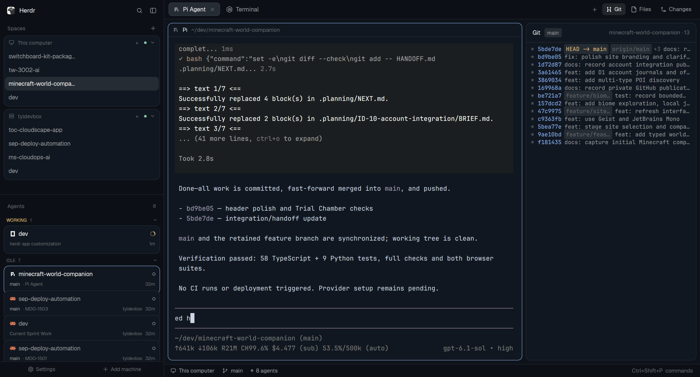

# Rotom

Herdr's own window with a live git graph in the right-hand panel, a deck of agent
cards in the sidebar ordered by what needs you, a Files panel still one click
away, and a `needs login` link that runs the machine's login command where you
can actually see its password prompt.

## What you see

The whole window uses Herdr's built-in `ink` theme (a cool slate blue), set on
the layout root, so it looks the same whatever the app default is.

Left to right, the same three columns as Herdr's `main` layout.

**Sidebar** — 268 px, `chrome` background, not resizable; folds to a 44 px rail
(76 px on macOS, room for the traffic lights) when dragged narrower, and its
mods draw a compact rail below 160 px.

- A 46 px brand strip at the top (`workspace-chrome`), draggable to move the
  window.
- A 34 px footer (`footer`): **Settings** and **Add machine** side by side,
  11 px `dim` text with a 13 px icon each, 6 px padding. In the rail only the
  icons show. Settings carries a 5 px accent dot when an update is ready.
- **Spaces** and the **Agents deck**, each a `weight: 1` block with `min: 90`.
- Each machine is one card, styled like the agent cards: `background`, 11 px
  radius, a 1 px `border` and a 2xs shadow. Its 30 px header holds a server or
  monitor icon, the machine name, its state, a `+` to make a space there, the
  status dot and the fold chevron; the machine's spaces are rows inside the
  card — the name in 12.5 px `muted` (`foreground` for the shown space), with
  `↑n`/`↓n` on the right when it is ahead or behind. The repo and branch text
  appears only while a row is hovered, or on the shown space. A machine in
  `needs_login` shows **needs login** in the theme's accent colour instead of
  the state word.
- Below the spaces, **Agents** is a deck of cards, one per agent, 62 px tall
  (54 px visible: each card tucks 8 px under the one above). A card is
  `background` (the same colour as the Git and terminal panels, not a grey
  surface), 11 px radius, a 1 px `border` and a faint 2xs shadow, clipped by
  the rounded edge.
  The top line is the program icon, the space name in semibold 12.5 px filling
  the row, and the status chip. The bottom line is 10 px: the branch in
  `muted`, then the tab title after a `·`, the machine name, and the time since
  the agent's state changed. On hover the
  border turns `input`, a 30% `hover` wash shows, the pin button replaces the
  duration; the focused card's border is `accent`.
- Deck sections are small 9.5 px semibold headers, coloured by their status:
  **NEED YOU**, **DONE**, **WORKING**, **IDLE**, each with a count and a fold
  chevron. Idle starts folded. Sub-agents appear as 21 px mini-cards tucked
  under their parent, indented 16 px, on a `surface` background.

**Middle** — a 42 px tab bar (draggable) over the work area. Tabs are 29 px
pills with the program icon, name, a spinner while an agent works, a status dot
when it is blocked or done, and a close button on the active one. `+` opens the
`new-menu` popup (250 × 512). The active tab's panes are cards: 8 px gap, 10 px
radius, 1 px `border`, 1 px `accent` border on focus, and a 30 px header drawn
by the shipped `pane` mod, always visible.

**Right panel** — a 368 px column (min 280, max 900) holding a stack of three
panels, with **Git** active:

- **Git** — 42 px header: "Git" in semibold, a branch pill (6/1 px padding,
  4 px radius, `raised` background, 11.5 px `muted` text), and at the right the
  repo folder name and commit count in 12 px `dim`.
  Below, a monospace list (12.2 px, `settings().font_family`, else JetBrains
  Mono): 17 px rows, 6 px vertical and 10 px horizontal padding. Each row is
  `graph prefix` in `dim`, a 7-character hash in `accent`, up to two ref pills
  on `raised` (a `+N` in `dim` beyond that), then the subject in `muted`,
  truncated. Ref pill colours: `HEAD…` in `working`, `tag:…` in `blocked`,
  anything with a `/` in `dim`, other branches in `done`.
  With no repo it says "Not a git repository" in 12 px `dim`; while loading,
  "Loading commits…".
- **Files** and **Changes** — the shipped panels, unchanged, behind their own
  buttons in the tab bar.

**Status bar** — 28 px `workspace-status` along the bottom.

## How it behaves

- The Git panel shows `git log --graph --all --decorate --date-order --oneline
  -n 300` for the focused pane's folder, falling back to the focused terminal's
  folder and then the active space's folder. On another machine it runs there.
  It asks `git rev-parse --show-toplevel` once per folder and caches the answer,
  re-asks when the focused folder changes, and refreshes the log every 5 s. A
  redraw happens only when the output, repo, or error actually changed.
- A folder that is not a repo is **not** an error state to fix: the panel says
  "Not a git repository".
- The tab bar's **Git**, **Files**, and **Changes** buttons switch that stack.
  Clicking the active one closes the panel (`layout.hide panel`); clicking
  another selects it (`layout.select panel-body <id>`) and shows the panel. The
  choice is remembered per space in `localStorage` under `panels`.
- Tabs can be dragged to reorder (drop on another tab), double-clicked to
  rename, and right-clicked for the tab menu. The tab bar scrolls with the
  wheel. Tabs show the four agent states as in Herdr: **working** = spinner,
  **blocked** = status dot, **done** = status dot, **idle** = neither.
- The **agents deck** is ordered by urgency, not by space: **NEED YOU**
  (`blocked`) first, then **DONE**, then **WORKING**, then **IDLE**. A pin
  keeps an agent at the top of its own group. Within a group, the most recent
  state change wins, then `seq`. Clicking a card focuses that agent's pane;
  clicking a sub-agent mini-card peeks at it. The chevron on the sub-agent
  count folds that parent's helpers. Section headers fold their group and the
  choice is saved in `localStorage` under `sections`; idle starts folded.
  `agent.next` / `agent.prev` follow the deck's order.
- Narrow the sidebar below 160 px and both mods draw their rail: one numbered
  line per agent with just its status chip, and a `»` to restore the width.
- In the sidebar, a machine that is `needs_login` gets a clickable **needs
  login** link (accent, `foreground` on hover). Clicking it finds a live local
  shell — the focused one, else any live shell in the active tab — and sends
  `hc machine login <name>` there with `hc send` (paste + Enter). If no such
  shell exists it splits the current local tab downwards with that command as
  its `argv`; if the active space is on another machine it opens a tab in a
  local space instead, or a new local space. It checks `hc`'s exit code and
  shows the stderr as an error toast rather than claiming success.
- `ctrl-shift-l` cycles layouts; Herdr's own `main` is untouched and still
  available.

## Built from

The layout is `layouts/rotom.json`: one row root (`theme: "ink"`,
`titlebar: "none"`, `traffic_lights: [12, 16]`, `background: "canvas"`,
`terminal_padding: [14, 12]`, a 1 px `border` divider) with:

- `sidebar` — column, `{px: 268}`, `min: 44`, `max: 480`, `background: "chrome"`,
  `resizable: false`; children `brand` (block, `{px: 46}`, `window_drag: true`,
  mod `workspace-chrome`), `sidebar-lists` (column: `spaces` and `agents` blocks,
  `{weight: 1}`, `min: 90`, mods `spaces-login` and `agents-cards`), `sidebar-footer`
  (block, `{px: 34}`, mod `footer`).
- `work` — column, `resizable: false`; children `tabs` (block, `{px: 42}`,
  `window_drag: true`, mod `tabs-git`), `work-body` (row, `padding: 8`,
  `gap: 8`), `status` (block, `{px: 28}`, mod `workspace-status`).
- `work-body` holds `main` (block, content `{tab: "active"}` with the pane frame
  above) and `panel` (column, `{px: 368}`, `min: 280`, `max: 900`) containing
  `panel-body` (stack, `active: "git"`) with three blocks: `git` → mod
  `git-graph`, `files` → mod `files`, `changes` → mod `changes`.

The layout records `cloned_from: {name: "main", version: "0.1.13"}`.

**`mods/footer`** (new, small): a 34 px footer bar. Two flex-1 buttons, 11 px
`dim` text that turns `foreground` over a `hover` background, each with a
13 px icon from the shipped `workspace-chrome`: `settings.svg` for
`run("app.settings")` (plus the update dot from `updates().app.ready`) and
`plus.svg` for `run("mod.open", { name: "machine-add" })`. Below 160 px of
sidebar it drops the labels and keeps the icons.

**`mods/git-graph`** (new): `mod.json` is `{"place": "none", "title": "Git"}`.
`main.js` imports `View, div` from `gpui-kit`; `v_flex, h_flex` from
`gpui-base`; and `spaces, panes, focused, exec, theme, settings` from `herdr`.
It uses `exec("git", ["rev-parse", "--show-toplevel"], {cwd, on})` and
`exec("git", ["log", …], {cwd, on})`, `theme()` colours, `settings().font_family`,
and `cx.timer.every(5000, …)` with `cx.spawn` for the calls. `graph.svg` is a
two-lane commit glyph in `currentColor`, tinted by the tab button.

**`mods/tabs-git`** (clone of the shipped `tabs`, v0.1.13): identical except the
enabled button list is local — `const enabled = ["git", "files", "changes"]` —
and the Files button is joined by a Git button
(`panelButton("git", "Git", "mods/git-graph/graph.svg")`). It draws window
buttons on Linux and Windows (`win-min/max/restore/close.svg`) and leaves room
for macOS traffic lights.

**`mods/agents-cards`** (clone of the shipped `agents`, v0.1.13): the deck. It
keeps the shipped mod's state tracking (`changed` timestamps), the done-to-idle
hold, pin migration and sub-agent tree, and replaces the list with sections and
cards. It uses `agents()`, `terminals()`, `panes()`,
`spaces()`, `focused()`, `theme()`, `run("pane.focus" | "terminal.peek" |
"terminal.pin")` and `setAgentOrder`, with `.absolute()` layers, `.shadow_2xs()`,
`.opacity()` and native `.spin()` / `.loop()` animation. `localStorage` keys:
`changed`, `pins`, and `sections` (`{folded: [...], agents: [...]}`).

**`mods/spaces-login`** (clone of the shipped `spaces`, v0.1.13): the machine
card wrapper (`card(head, body, t)`), the `needs_login` branch in `grouped()`,
`login(name)`, and imports of `terminals, focused, notify`. It reads machine
state from `hc machine ls --json` (`state`, `target`), which the clone already
refreshes, and filters local terminals with `!t.machine &&
!String(t.address).includes("/")`.

Shipped pieces it leans on, all present in `~/.config/herdr-app/mods/`:
`workspace-chrome` (`spinner.svg`, `server.svg`, `monitor.svg`,
`chevron-down.svg`, `chevron-right.svg`, `plus.svg`), `pane`
(`close.svg`), `files` (`file.svg`), `changes` (`changes.svg`),
`workspace-status`, `new-menu`, `menu`.

Commands it calls: `layout.select`, `layout.show`, `layout.hide`, `space.new`,
`space.select`, `tab.new`, `tab.select`, `tab.move`, `tab.close`, `tab.rename`,
`pane.split`, `pane.zoom`, `pane.close`, `pane.focus`, `terminal.peek`,
`terminal.keep`, `terminal.copy`, `terminal.paste`, `terminal.right_click`,
`window.minimize`, `window.maximize`, `window.close`, `agent.next`, `agent.prev`.
Programs it runs: `git` (the graph), `hc` (`hc send`, `hc machine ls --json`),
and the shell commands the shipped `spaces` clone already runs for repo/branch
state.

The three clones are derived from Herdr's shipped mods (Apache-2.0). If Herdr
updates `tabs`, `spaces` or `agents`, diff against
`~/.config/herdr-app/mods/<name>` and re-apply the small changes above. Two
storage keys differ from the shipped mods: `spaces-login` stores machine folds
under `machines.folded.v2`, and `agents-cards` stores section folds under
`sections`.

## Watch out

- **The stack ids matter.** `tabs-git` calls `layout.select` with child ids
  `git`, `files`, and `changes`; rename a child in the layout and its button
  silently does nothing.
- **Never send the login command to the first local shell you find.** `hc send`
  does deliver to a terminal that is off screen, but the login prompts for a
  password there, so the person sees nothing and a second click types the
  command into that password prompt. Only use a shell in the focused terminal or
  the active tab.
- **Remote terminals are `machine/address`.** A bare `t3` is local; a remote one
  looks like `tyldevbox/t17`. Filter on the slash as well as `machine`.
- **The panel is narrow.** Two ref pills plus `+N` is the limit at 280–368 px;
  more pushes the subject out. Widen `panel` rather than raising the cap.
- **`git-graph` needs `git` on PATH** and caps the log at 300 commits. It makes
  no network calls and writes no files.
- **No repo is normal.** `~/dev` and any non-repo folder show "Not a git
  repository" by design.
- **`localStorage` key `panels`** holds each space's last panel; deleting it
  resets every space to closed.
- **Clones do not update.** That is the trade for editing them.
- **Mods are trusted code**, not sandboxed; these three run `git`, `hc`, and no
  `fetch`.

## Done when

1. `herdr-app check ~/.config/herdr-app/mods/git-graph` (and `tabs-git`,
   `spaces-login`) exits 0 with "check passed".
2. `herdr-app status` reports no errors from `layout`, `keys`, or these mods.
3. The layout loads and the right panel shows a git graph in a repo — graph
   lanes, 7-character hashes, ref pills, subjects — and "Not a git repository"
   in a folder that is not a repo.
4. The tab bar shows **Git**, **Files**, **Changes**; each switches the panel,
   and clicking the active one closes it. Switching spaces restores that
   space's last panel choice.
5. With a machine in `needs_login`, the sidebar shows an accent **needs login**
   link. Clicking it types `hc machine login <name>` into a visible local shell,
   or opens a split running it; the command never appears in a
   `machine/address` terminal.
6. The window matches `preview.png` (allowing for different content in the
   tabs, sidebar, and graph).
